# A Split Keyboard, Built from Scratch

## Overview

This is a custom spli keybaord with the 1.8inch tft diaply and rotatory encoder and also with nfc based lock system with the controlable backlight . This keyboard can be used as wired keybaord as well as the wireless keybaord with the 2 bluetooth profile 

---

## Key Features

### Split Mechanical Layout

Two separate keyboard halves, each built around its own ESP32-S3 microcontroller and supporting electronics.
 Each side having 21 MX switches and with the backlight. 
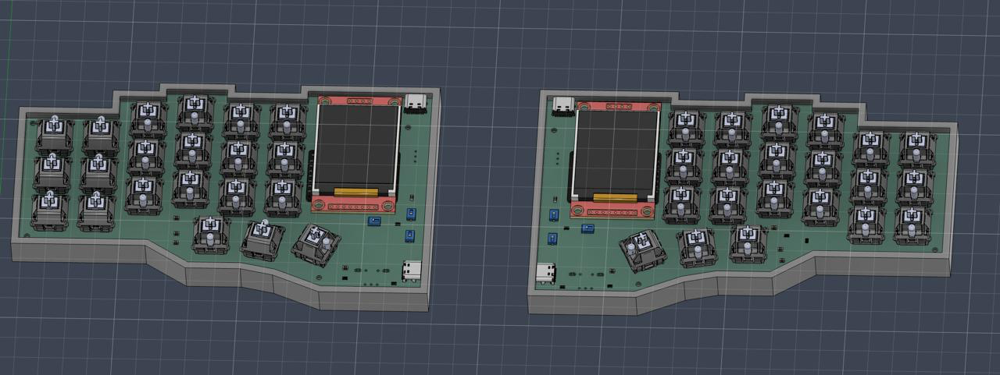

### Rotary Encoder Controls

EC11 rotary encoders provide physical controls for functions such as volume and brightness.

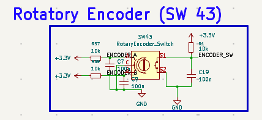

### TFT Display

Two 1.8-inch TFT displays are included for displaying system information such as battery percentage and connectivity status. Can also play animation on idle state.

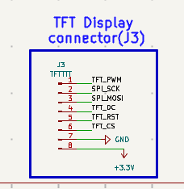

### RFID Integration

RC522 readers provide the hardware for RFID card detection and card-based interactions used to unlock the keyboard or the PC depend on the firmware either use it as the keyboard lock or use it to open the pc via your nfc tag or the phone nfc 

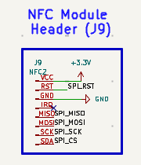

### Rechargeable Power

Each half has a rechargeable 10000 mah LiPo battery witht he inbuilt BMS which power up the whole half and can provide long lasting backup on the bluetooth mode .

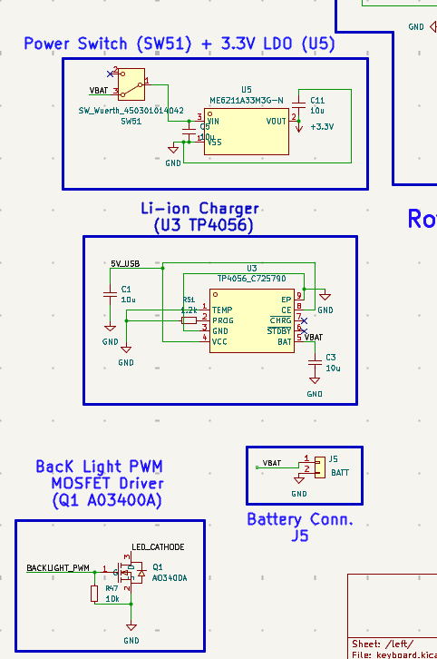

### Per-Key Backlighting

White 0805 SMD LEDs are use to work as the backlight like professional keybaord with the intensity control uc an control the backlight intensity with the same rotatory encoder 

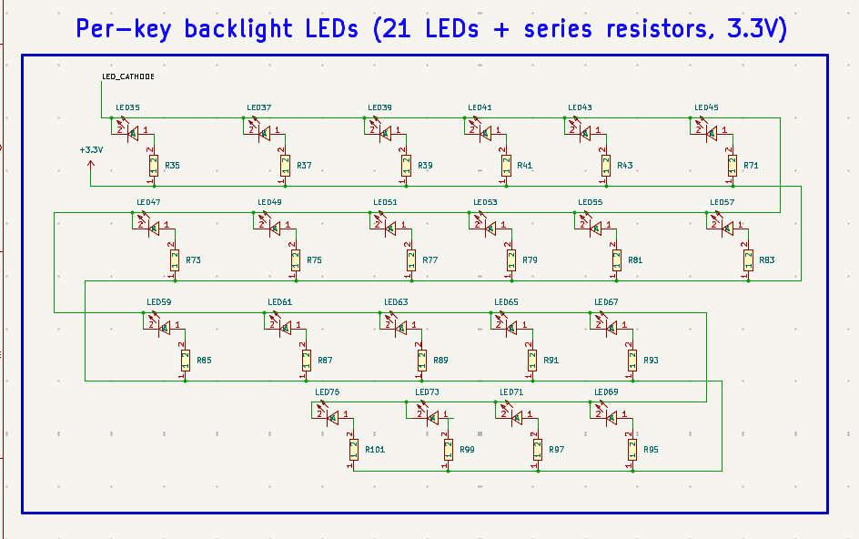

---

## Schematic Design

### Key Switch Matrix

The switch matrix connects the mechanical switches to the microcontroller. Diodes help prevent unwanted electrical paths during simultaneous key presses.

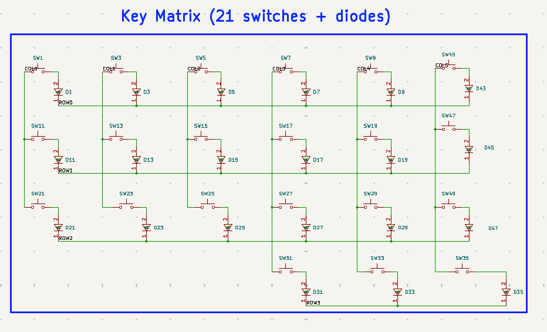

### Switches and Diodes

Mechanical switches provide individual key inputs, while 1N4148WS diodes support switch-matrix isolation.

### Resistors and LEDs

Resistors support the associated circuits, while white SMD LEDs provide per-key backlighting.

### Microcontroller

The ESP32-S3-WROOM-1-N4R8 acts as the main controller for each keyboard half.

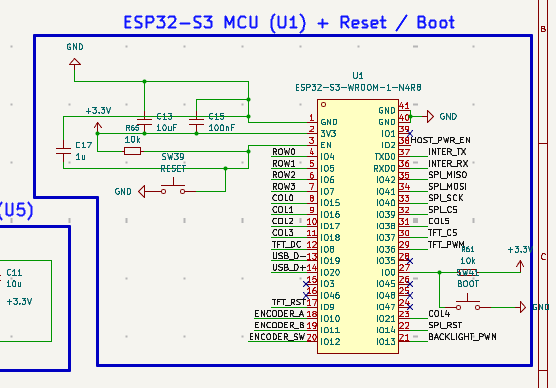

### Rotary Encoders

The EC11 encoders provide rotation and switch inputs for additional keyboard controls.

### Display Circuit

The display connections allow the ESP32-S3 to communicate with the TFT modules.

### RFID Circuit

The RC522 reader connections provide the interface for RFID card detection.

### Power Management

The power circuit includes LiPo battery charging, 3.3 V regulation, MOSFET switching, and resettable overcurrent protection.

### USB-C Connectivity

USB-C connectors provide the interfaces intended for charging, firmware uploading, and supported wired connections.

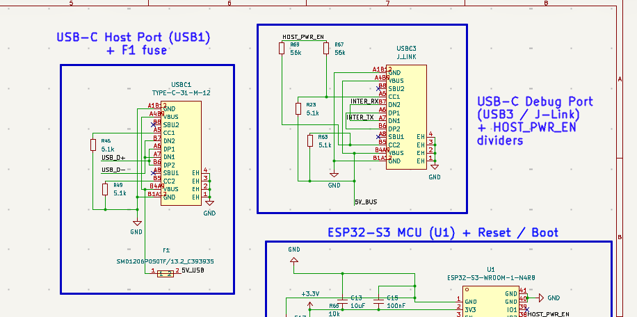

---

## PCB Design

The custom schematic and PCB layout were designed in KiCad, with the boards manufactured by Zbotic. The PCB integrates the keyboard matrix, controller connections, peripheral interfaces, backlighting, and power circuitry.

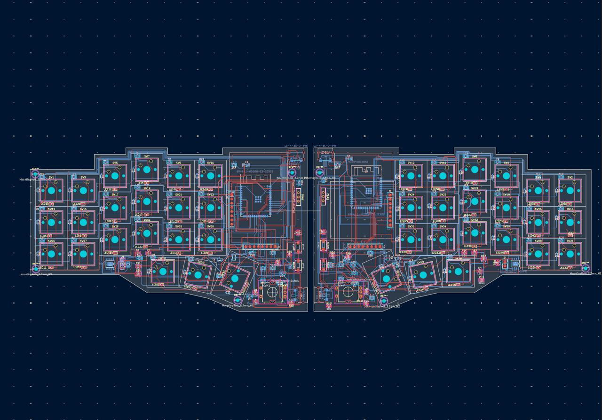

---

## CAD Design

The keyboard enclosure is modelled in Fusion 360 to accommodate the custom PCB, switches, displays, rotary encoders, and internal electronics.

### Enclosure

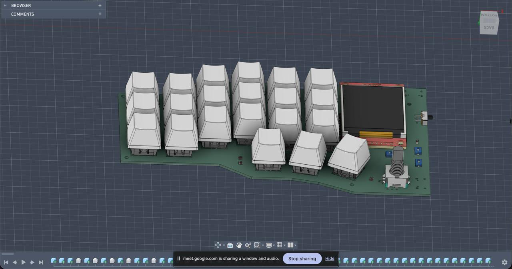

### Complete Assembly

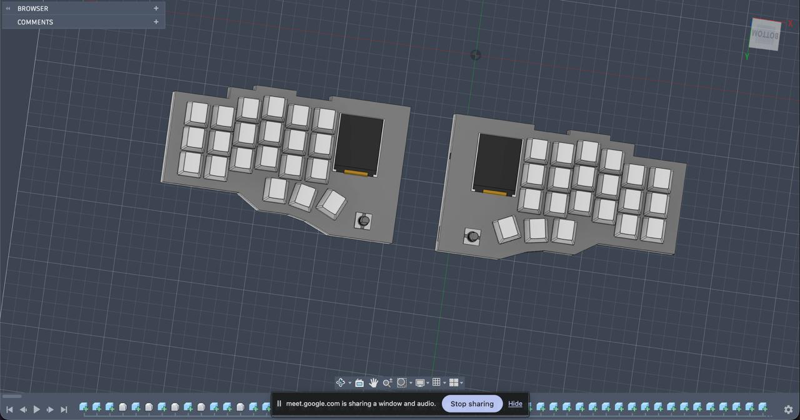

---

## Firmware

The firmware is implemented using the Arduino framework and PlatformIO for the ESP32-S3 microcontrollers. It enables wireless communication between the two halves of the split keyboard using ESP-NOW, while the left half acts as the primary Bluetooth HID device.

The firmware scans the 4 × 6 key matrix, detects key presses and releases, and maps them to keyboard characters. The left half sends keystrokes to the connected device over Bluetooth Low Energy (BLE), while the right half transmits key events wirelessly to the left half.

The implementation uses the `BleKeyboard` library for Bluetooth keyboard functionality and ESP-NOW for communication between the two halves. The current firmware provides the foundation for the keyboard's core input functionality and can be extended with additional key mappings, layers, and peripheral integrations.

---

## Bill of Materials (BOM)

The following table lists the components required to build the REIKAI split mechanical keyboard, including specifications, quantities, estimated costs, and sourcing links.

### Component Breakdown

| Category | Component | Qty | Specifications | Unit Price (INR) | Total (INR) | Unit Price (USD) | Total (USD) | Source |
|---|---|---:|---|---:|---:|---:|---:|---|
| Processing & Communications | ESP32-S3-WROOM-1 | 2 | Dual-core, Wi-Fi/BLE, 16MB Flash, 8MB PSRAM | ₹569.00 | ₹1,138.00 | $6.0324 | $12.06 | [Robu](https://robu.in/product/espressif-esp32-s3-wroom-1-n16r8-module/) |
| Processing & Communications | RC522 Mini NFC Module | 2 | Mini PCB, SPI interface | ₹139.00 | ₹278.00 | $1.4736 | $2.95 | [Indian Hobby Center](https://www.indianhobbycenter.com/products/rc522-mini-rfid-reader-writer-spi-s50-with-rfid-card-and-tag) |
| Processing & Communications | 1.8" TFT Display | 2 | SPI interface, ST7735 | ₹309.00 | ₹618.00 | $3.2759 | $6.55 | [Robu](https://robu.in/product/62060/) |
| Inputs & Key Matrix | MX Mechanical Switches | 42 | Cherry MX2A, ₹391 per pack of 10 | ₹39.10 | ₹1,642.20 | $0.4145 | $17.41 | [Meckeys](https://meckeys.com/shop/accessories/keyboard-accessories/key-switches/cherry-mx2a-mechanical-switch/) |
| Inputs & Key Matrix | Switch Diodes | 42 | 1N4148WS, SOD-323 | ₹1.09 | ₹45.78 | $0.0116 | $0.49 | [Sunrom](https://www.sunrom.com/p/1n4148---1n4148ws---t4---smd---sod323-0805) |
| Inputs & Key Matrix | EC11 Rotary Encoder | 2 | 5-pin, through-hole, push button | ₹58.00 | ₹116.00 | $0.6149 | $1.23 | [Robu](https://robu.in/product/hongyan-ec11h-7ce15p1zd15f7-rotary-encoder-with-push-button-switch-vertical-plug-in-5-pin-360-degree/) |
| Illumination | 0805 White LEDs | 42 | SMD backlight LEDs | ₹0.58 | ₹24.36 | $0.0061 | $0.26 | [KTRON](https://www.ktron.in/product/smd-white-led-0805-package/) |
| Illumination | AO3400A N-Channel MOSFET | 2 | SOT-23, LED PWM dimming | ₹6.00 | ₹12.00 | $0.0636 | $0.13 | [Robu](https://robu.in/product/1-month-warranty-414/) |
| Power & Connectivity | USB Type-C Receptacle | 4 | 16-pin SMD connector | ₹5.55 | ₹22.20 | $0.0588 | $0.24 | [KTRON](https://www.ktron.in/product/16-pin-usb-type-c-connector-smd/) |
| Power & Connectivity | 10,000 mAh LiPo Battery | 2 | Single-cell, 3.7V–4.2V | ₹399.00 | ₹798.00 | $4.2301 | $8.46 | [MakerBazar](https://makerbazar.in/products/single-cell-3-7v-10000mah-lipo-battery) |
| Power & Connectivity | TP4056 IC | 2 | SOP-8, LiPo charger | ₹5.05 | ₹10.10 | $0.0535 | $0.11 | [KTRON](https://www.ktron.in/product/tp4056-ic/) |
| Power & Connectivity | ME6211A33M3G IC | 2 | SOT-23-5, 3.3V LDO regulator | ₹8.00 | ₹16.00 | $0.0848 | $0.17 | [Robu](https://robu.in/product/me6211c33m5g-n-microne-500ma-fixed-3-3v-positive-electrode-6v-sot-23-5-voltage-regulators-linear-low-drop-out-ldo-regulators-rohs/) |
| Power & Connectivity | Resettable PTC Fuse | 2 | 1206, 500mA | ₹9.00 | ₹18.00 | $0.0954 | $0.19 | [Robu](https://robu.in/product/smd1206-050c-6v-bnstar-6v-40a-500ma-1a-1206-resettable-rohs/) |
| Power & Connectivity | SMD Push Switches | 4 | 3×4×2.5mm, BOOT/EN | ₹4.29 | ₹17.16 | $0.0455 | $0.18 | [Robu](https://robu.in/product/tsa043a2026a-bzcn-3x4x2-5-50ma-round-button-50gf-12v-smd-tactile-switches-rohs/) |
| Power & Connectivity | Slide Switch | 2 | SPDT, battery disconnect | ₹2.70 | ₹5.40 | $0.0286 | $0.06 | [Robu](https://robu.in/product/1-month-warranty-254/) |
| Supporting Passives | 100Ω Resistor | 42 | 0805 SMD, LED current limiting | ₹0.30 | ₹12.60 | $0.0032 | $0.13 | [KTRON](https://www.ktron.in/product/resistor-100-ohms-1-1-8w-smd-0805/) |
| Supporting Passives | 10kΩ Resistor | 12 | 0805 SMD, pull-up/pull-down | ₹0.30 | ₹3.60 | $0.0032 | $0.04 | [KTRON](https://www.ktron.in/product/resistor-10k-ohms-1-1-8w-smd-0805/) |
| Supporting Passives | 56kΩ Resistor | 4 | 0805 SMD, HOST_PWR_EN divider | ₹0.30 | ₹1.20 | $0.0032 | $0.01 | [KTRON](https://www.ktron.in/product/resistor-56k-ohms-1-1-8w-smd-0805/) |
| Supporting Passives | 5.1kΩ Resistor | 4 | 0805 SMD, HOST_PWR_EN divider | ₹0.30 | ₹1.20 | $0.0032 | $0.01 | [KTRON](https://www.ktron.in/product/resistor-5k1-ohms-5-1-8w-smd-0805/) |
| Supporting Passives | 1.2kΩ Resistor | 2 | 0805 SMD, TP4056 PROG pin | ₹0.30 | ₹0.60 | $0.0032 | $0.01 | [KTRON](https://www.ktron.in/product/resistor-1k2-ohms-1-1-8w-smd-0805/) |
| Supporting Passives | 10µF Capacitor | 10 | 0805 SMD, decoupling | ₹7.98 | ₹79.80 | $0.0846 | $0.85 | [KTRON](https://www.ktron.in/product/10uf-50v-multi-layered-ceramic-capacitor-mlcc-x5r-smd-0805-yageo-cc0805kkx5r9bb106/) |
| Supporting Passives | 1µF Capacitor | 2 | 0805 SMD, power filtering | ₹8.50 | ₹17.00 | $0.0901 | $0.18 | [KTRON](https://www.ktron.in/product/1uf-50v-multi-layered-ceramic-capacitor-yageo/) |
| Supporting Passives | 100nF Capacitor | 8 | 0805 SMD, noise decoupling | ₹1.00 | ₹8.00 | $0.0106 | $0.08 | [KTRON](https://www.ktron.in/product/100nf-25v-multi-layered-ceramic-capacitor/) |
| PCB | Custom PCB | 1 | Custom-designed PCB fabrication | ₹4,243.50 | ₹4,243.50 | $45.00 | $45.00 | [Zbotic](https://zbotic.in/) |

### Cost Summary

| Description | Amount |
|---|---:|
| **Grand Total (INR)** | **₹9,128.80** |
| **Grand Total (USD)** | **$96.80** |

## Tools & Technologies

- **PCB Design:** KiCad
- **CAD Modelling:** Fusion 360
- **Firmware:** Cpp, ESP-IDF, FreeRTOS
- **Microcontroller:** ESP32-S3
- **PCB Manufacturing:** Zbotic