# A Split Keyboard, Built from Scratch

## Overview

This is a custom split mechanical keyboard designed from the ground up, combining custom electronics, embedded firmware, and 3D CAD. It brings together programmable controls, displays, RFID-based interactions, rechargeable batteries, and per-key backlighting in one custom-built project.

---

## Key Features

### Split Mechanical Layout

Two separate keyboard halves, each built around its own ESP32-S3 microcontroller and supporting electronics.

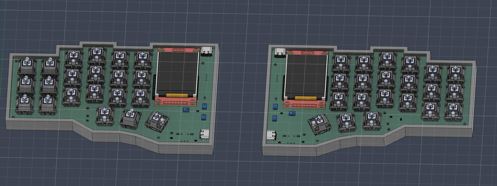

### Rotary Encoder Controls

EC11 rotary encoders provide physical controls for functions such as volume and brightness.

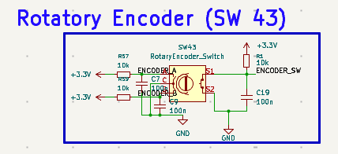

### TFT Display

Two 1.8-inch TFT displays are included for displaying system information such as battery percentage and connectivity status.

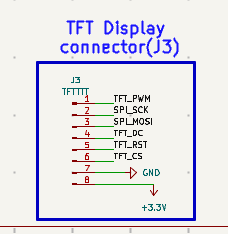

### RFID Integration

RC522 readers provide the hardware for RFID card detection and card-based interactions.

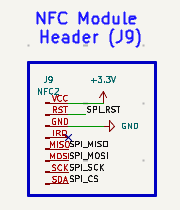

### Rechargeable Power

Each half has a rechargeable LiPo battery and dedicated charging and voltage-regulation circuitry.

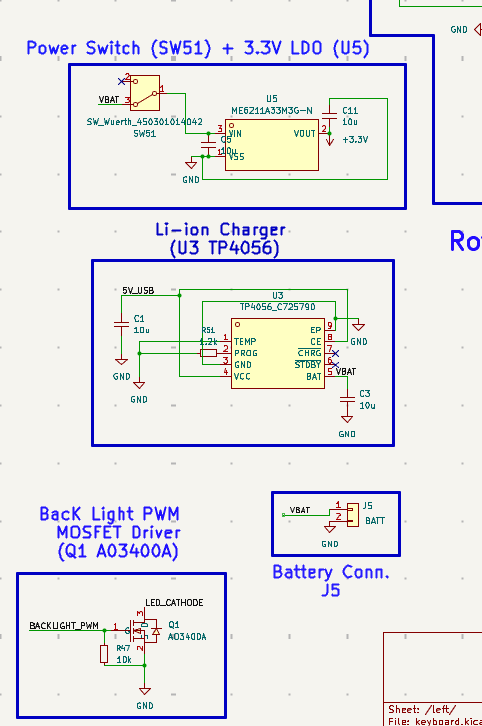

### Per-Key Backlighting

White SMD LEDs are integrated into the PCB to illuminate the keyboard.

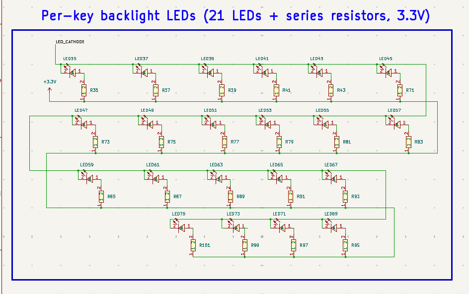

---

## Schematic Design

### Key Switch Matrix

The switch matrix connects the mechanical switches to the microcontroller. Diodes help prevent unwanted electrical paths during simultaneous key presses.

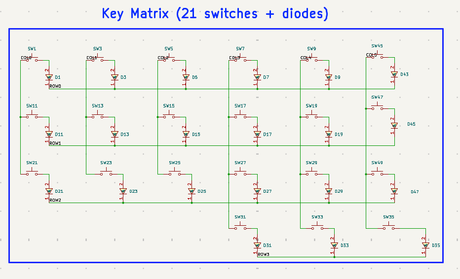

### Switches and Diodes

Mechanical switches provide individual key inputs, while 1N4148WS diodes support switch-matrix isolation.

### Resistors and LEDs

Resistors support the associated circuits, while white SMD LEDs provide per-key backlighting.

### Microcontroller

The ESP32-S3-WROOM-1-N4R8 acts as the main controller for each keyboard half.

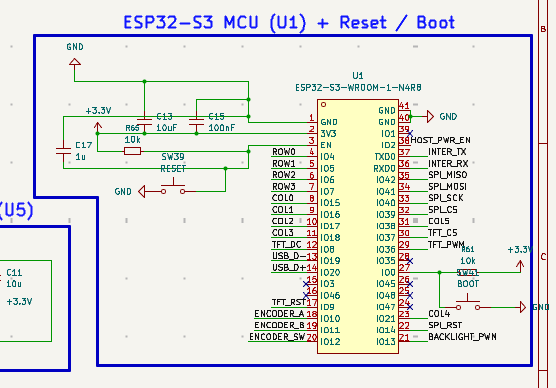

### Rotary Encoders

The EC11 encoders provide rotation and switch inputs for additional keyboard controls.

### Display Circuit

The display connections allow the ESP32-S3 to communicate with the TFT modules.

### RFID Circuit

The RC522 reader connections provide the interface for RFID card detection.

### Power Management

The power circuit includes LiPo battery charging, 3.3 V regulation, MOSFET switching, and resettable overcurrent protection.

### USB-C Connectivity

USB-C connectors provide the interfaces intended for charging, firmware uploading, and supported wired connections.

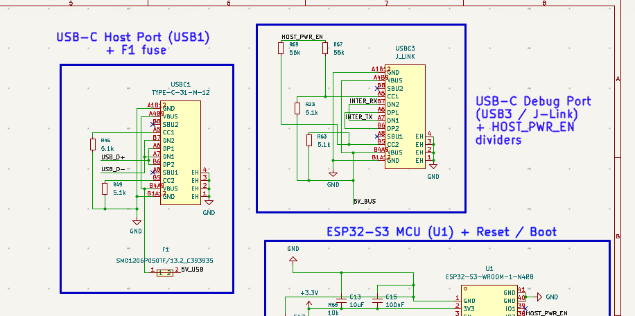

---

## PCB Design

The custom schematic and PCB layout were designed in KiCad, with the boards manufactured by Zbotic. The PCB integrates the keyboard matrix, controller connections, peripheral interfaces, backlighting, and power circuitry.

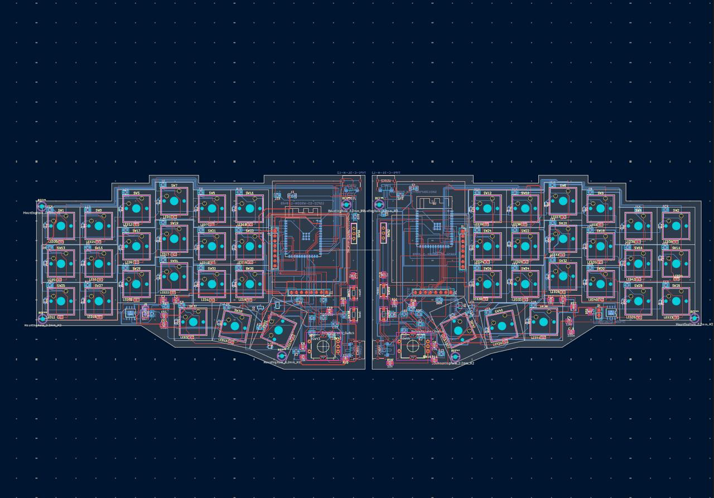

---

## CAD Design

The keyboard enclosure is modelled in Fusion 360 to accommodate the custom PCB, switches, displays, rotary encoders, and internal electronics.

### Enclosure

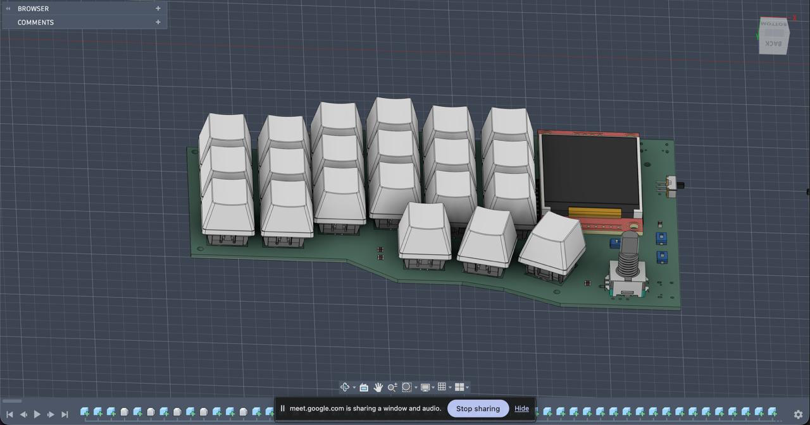

### Complete Assembly

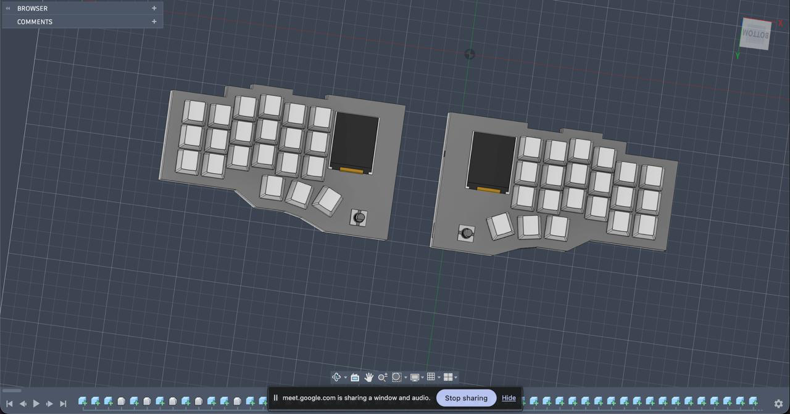

---

## Firmware

The current firmware is still largely vibe-coded and needs proper manual optimisation. The plan is to review the existing code, understand each component, improve the logic, and refactor or replace parts wherever necessary.

The goal is to move beyond AI-generated code, make the firmware cleaner and more efficient, and get the keyboard working as a fully functional custom build.

---

## Bill of Materials (BOM)

| Part                            | Description.                  | Qty  | Unit  | Total  | Vendor.           |
| :---                            | :---                          | :--- | :---  | :---   | :---              |
| ESP32-S3-WROOM-1 Module         |        MCU.                   | 2    | $4.37 | $8.74  | [Robu.in](https://robu.in/) |
| Rotary Encoder                  | Volume and brightness control | 2    | $0.64 | $1.28  | [Robu.in](https://robu.in/) |
| NFC RFID Reader                 | For device unlocking          | 2    | $1.44 | $2.88  | [IndianHobbyCenter](https://www.indianhobbycenter.com/) |
| 2000mAh 3.7V Micro LiPo Battery | Power Source                  | 2    | $3.43 | $6.86 | [Robu.in](https://robu.in/) |
| TP4056 IC                       | Charging IC                   | 2    | $2.00 | $4.00 | [Ktron.in](https://www.ktron.in/) |
| ME6211C33M5G                    | Regulators                    | 2    | $0.08 | $0.16 | [Robu.in](https://robu.in/) |
| AO3400A-HUASHUO                 | LED MOSFET                    | 2    | $0.06 | $0.12 | [Robu.in](https://robu.in/) |
| SMD1206B050TF                   | Fuse                          | 1    | $0.05 | $0.05 | [Robu.in](https://robu.in/) |
| Type-C Connector                | Charging and interconnection  | 4    | $0.27 | $1.08 | [Robu.in](https://robu.in/) |
| 1N4148WS                        | Diodes                        | 50   | $0.12 | $6.00 | [Robu.in](https://robu.in/) |
| LED                             | Backlight                     | 50   | $0.01 | $0.50 | [Robu.in](https://robu.in/) |
| Resistor                        | LED protection and other things| 60  | $0.01 | $0.60 | [Ktron.in](https://www.ktron.in/) |
| Capacitors                      | Component electrical stability| 30   | $0.01 | $0.30 | [Ktron.in](https://www.ktron.in/) |
| Gateron Oil King                | Switches                      | 5    | $2.58 | $12.90 | [Meckeys](https://www.meckeys.com/) |
| PCB                             | Component housing             | 1    | $45.00 | $45.00 | [Zbotic](https://zbotic.in/) |
| Case (own)                      | Housing of all electronics    | 1    | $20.00 | $20.00 | [Printing Legion](https://printinglegion.com/) |
| 1.8" TFT Display                | Display                       | 2    | $3.19 | $6.38 | [Robu.in](https://robu.in/) |
| Slide Switch                    | Power control                 | 2    | $0.01 | $0.02 | [Robu.in](https://robu.in/) |
| SMD Switches                    | Reboot and flash              | 1    | $0.21 | $0.21 | [MakerBazar](https://makerbazar.in/) |
| **TOTAL** | | | | **$97.02** | |
---

## Tools & Technologies

- **PCB Design:** KiCad
- **CAD Modelling:** Fusion 360
- **Firmware:** C, ESP-IDF, FreeRTOS
- **Microcontroller:** ESP32-S3
- **PCB Manufacturing:** Zbotic